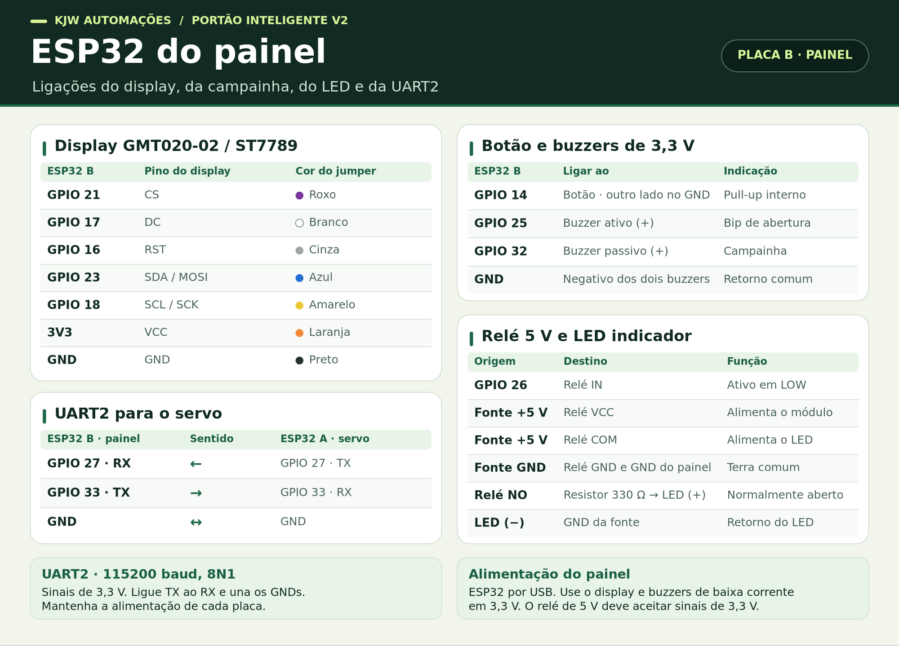
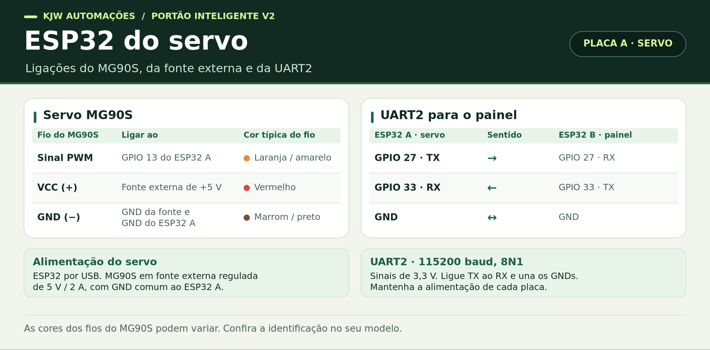

# Portão Inteligente · KJW Automações

Uma visita toca a campainha quando o responsável está longe do portão. O painel toca uma melodia e sinaliza o toque. O celular recebe o aviso e permite ao responsável decidir se abre a maquete, fechá-la depois e consultar o horário dos eventos.

Projeto acadêmico de **Kaique Alves, João Leal e Wuender Bueno**.

## Como funciona

- **ESP32 do painel** lê o botão e toca a campainha de estilo 8 bits. O LCD mostra hora, data, último toque e estado do portão. O relé aciona um LED e o buzzer ativo sinaliza uma nova abertura concluída.
- **ESP32 do servo** controla um MG90S, fornece ao painel a hora e o estado e encaminha os eventos ao servidor por Wi-Fi. As duas placas trocam mensagens **JSON v2 em UART2 a 115200 baud**. O GPIO 27 leva dados do servo ao painel, e o GPIO 33 leva dados do painel ao servo. Os GNDs das duas placas devem estar unidos.
- **Servidor Node.js 24** recebe o servo e o app em `/ws`, grava eventos em SQLite e envia avisos ao serviço Expo Push quando há celulares registrados. O acesso externo usa **WSS**. O repositório inclui Caddy e Docker Compose.
- **App React Native + Expo** mostra conectividade, avisos em tempo real, **Abrir portão**, **Fechar portão** e histórico paginado. Push em segundo plano depende de um build próprio, permissões e da configuração do Expo e de FCM ou APNs.

O portão é uma maquete com posição **estimada pelo ângulo comandado**. O botão físico toca a campainha, e o responsável decide pelo app se abre ou fecha a maquete.

## Montagem e execução

| Material | Conteúdo |
| --- | --- |
| [Arquitetura e protocolo](docs/arquitetura.md) | Mensagens, relógios, estados, histórico e comportamento offline |
| [Montagem de bancada](docs/montagem.md) | Componentes, ligações, GPIOs e alimentação |
| [Instalação e configuração](docs/instalacao.md) | Servidor, duas placas, app, push e hospedagem WSS |
| [Validação](VALIDACAO.md) | Testes executados, comandos e verificações de bancada pendentes |
| [Teste do buzzer](TESTE_BUZZER.md) | Diagnóstico pelo monitor serial e sketch isolado |
| [Roteiro ao vivo](docs/demonstracao.md) | Preparação, ações e plano de contingência |
| [Apresentação editável](apresentacao/Portao-Inteligente-KJW-UART.pptx) | Oito slides com notas de fala |

Leia a [ordem sugerida para a primeira bancada](LEIA_PRIMEIRO.md). Use os arquivos `.env.example`, `config.example.h` e `root_ca.example.h` como base para a configuração local.

### Painel em funcionamento

Prévia renderizada pelo código do LCD, com data e horários de exemplo. O relógio usa UTC−4.

### Ligações das placas

Ligue o **GPIO 27 (TX) do servo** ao **GPIO 27 (RX) do painel** e o **GPIO 33 (TX) do painel** ao **GPIO 33 (RX) do servo**. Una os GNDs das duas placas. O [guia de montagem](docs/montagem.md) detalha a alimentação e os periféricos.

#### ESP32 B · painel

#### ESP32 A · servo

