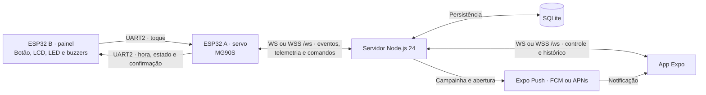

# Arquitetura e protocolo da v2

As placas trocam mensagens JSON de protocolo 2 em **UART2 a 115200 baud, 8N1**, com quadros delimitados por quebra de linha. O GPIO 27 transmite do servo para o painel, e o GPIO 33 transmite do painel para o servo. Os GNDs são comuns. O ESP32 A usa Wi-Fi para se conectar ao servidor Node em `/ws`. O app abre sua própria conexão com esse endpoint. Na bancada, o servidor escuta em WS na porta 3000. O acesso remoto usa WSS na porta 443, com Caddy/Compose disponível no projeto.

## Da campainha ao celular

1. O botão aciona a melodia do buzzer passivo e a mensagem **Campainha tocando**. O painel cria o evento `doorbell`, com ID único e horário quando o relógio estiver válido. Tenta gravar o evento no LittleFS e guarda o horário do último toque no NVS.
2. O painel envia `peer_auth` a cada segundo, com ID, chave compartilhada e identificador de inicialização. O servo valida a mensagem e devolve `peer_ready` com o próprio identificador e a hora, quando disponível. A troca dos identificadores confirma a comunicação nos dois sentidos. O painel envia `peer_event`, e o servo responde `peer_event_ack` após salvar o evento na fila dele.
3. O servo encaminha `event` ao servidor. O servidor persiste o evento por ID no SQLite e confirma com `event_ack`. Cada placa remove da própria fila após receber a confirmação do próximo nó. As filas comportam até 128 eventos por placa.
4. O app conectado recebe o evento ao vivo e acrescenta o registro ao histórico. Com push habilitado, o servidor também enfileira notificações de campainha e abertura concluída, consulta recibos e remove tokens rejeitados como `DeviceNotRegistered`.

## Do celular ao mecanismo

O app e o servo se autenticam com um frame `auth`, `protocol: 2` e o token do respectivo papel (`app` ou `servo`). O servo também envia `deviceId` e `bootId`. O servidor retorna `ready` e entrega um `snapshot` inicial ao app com estado e histórico. As solicitações usam `request` com `requestId`, `method` e `data`. A resposta `response` contém o mesmo ID e resultado ou erro.

| Método do app | Dados principais | Resultado |
| --- | --- | --- |
| `status` | Sem parâmetros | Estado, ângulos e conectividade |
| `history` | `limit`, `before` opcional | Eventos por sequência e cursor da próxima página |
| `command` | `id`, `action` (`open` ou `close`), `expiresAt` | Encaminha a ação ao servo quando disponível |
| `command_status` | `id` | Consulta o resultado pelo mesmo ID |
| `push_register` / `push_remove` | Token Expo | Ativa ou retira o celular da lista de celulares que recebem push |

O servidor recusa comandos vencidos ou concorrentes e comandos novos com o servo offline. O prazo é de até 5 s para iniciar o comando. O servo valida o prazo, guarda o último ID em NVS e publica `telemetry`. Após uma desconexão, o app consulta o comando pelo ID. O movimento já iniciado termina localmente. Um reinício do servidor marca comandos em andamento como interrompidos.

O ESP32 A envia `gate_state` ao painel. O LCD mostra **Fechado**, **Abrindo**, **Aberto** ou **Fechando**. O ângulo comandado aparece no app como posição estimada. O LED fica aceso durante abertura, aberto e fechamento, e apaga ao receber o estado fechado. Quando o painel recebe ao vivo uma nova conclusão de abertura, o buzzer ativo toca por 250 ms. A tela mostra **SEM SINAL** quando passam 3 s sem atualizar o enlace e o LED conserva a última indicação conhecida. O painel envia apenas eventos de campainha, e o servo recebe os comandos pelo servidor. A posição da maquete é deduzida da rampa comandada, sem sensores de posição, passagem ou obstáculo.

## Relógios, armazenamento e histórico

- **Placas.** O ESP32 do servo sincroniza a hora por NTP assim que se conecta ao Wi-Fi, usando os endereços configurados no firmware. Em `peer_ready`, envia `epochSeconds` ao painel pela UART. O LCD mostra a data, a hora e o último toque em **UTC−4**, e exibe `--:--` e **Aguardando hora** antes da primeira sincronização. Os timestamps dos eventos usam `occurredAt` (Unix em milissegundos) quando a hora é válida.
- **Servidor.** Registra `receivedAt` ao persistir o evento. O app exibe o horário da ocorrência ou, se faltar, o da recepção com a indicação **recebido no servidor**, conforme o fuso do celular. `serverTime` em `ready` e `clock` orienta a validade de comandos no servo. TLS no servo também exige relógio NTP válido.
- **Histórico.** Inclui início do servo, toques, pedidos do app, início dos movimentos, abertura, fechamento, posição já selecionada e rejeições do servo. Eventos repetidos compartilham o mesmo ID e são deduplicados. A paginação segue a ordem de inserção, então toques acumulados offline podem entrar depois de eventos ocorridos mais tarde.
- **Reconexão.** Com LittleFS disponível e espaço na fila, o toque pode ser encaminhado depois que o link voltar. O áudio local continua durante a queda. A fila de push é persistida no servidor e uma falha no serviço de push é independente do histórico.

Código de referência no projeto. [Painel](../firmware/esp32_painel/esp32_painel.ino) · [Servo](../firmware/esp32_servo/esp32_servo.ino) · [Servidor](../server/server.mjs) · [App](../app/App.js)
