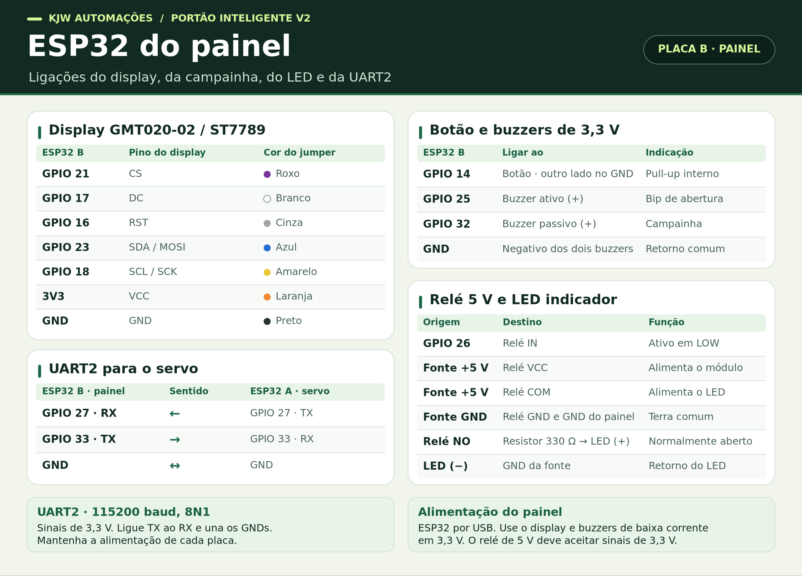
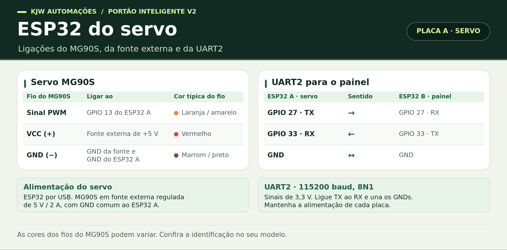

# Montagem da maquete

Separe dois ESP32 clássicos WROOM-32/DevKit com Wi-Fi de 2,4 GHz, cabos USB, jumpers, um servo MG90S, um display GMT020-02/ST7789, um botão momentâneo, um módulo de relé de 5 V compatível com sinal de 3,3 V, um LED, um resistor de 330 Ω e dois buzzers de 3,3 V e baixa corrente, um ativo e um passivo. A referência da bancada indica uma fonte regulada externa de **5 V / 2 A** para o servo.

## ESP32 B · painel

### Display GMT020-02 / ST7789

| ESP32 B | Pino do display | Cor do jumper na maquete |
| --- | --- | --- |
| **GPIO 21** | CS | Roxo |
| **GPIO 17** | DC | Branco |
| **GPIO 16** | RST | Cinza |
| **GPIO 23** | SDA / MOSI | Azul |
| **GPIO 18** | SCL / SCK | Amarelo |
| **3V3** | VCC | Laranja |
| **GND** | GND | Preto |

O display usa **SPI** e `init(240, 320)` com rotação 1, resultando em paisagem de **320 × 240**. Os rótulos SDA e SCL desse módulo identificam MOSI e SCK. Se o display tiver um terminal BL/BLK separado, confira a especificação do seu módulo antes de ligá-lo. Use GPIOs 16/17 disponíveis na placa escolhida.

### Botão e buzzers de 3,3 V

| ESP32 B | Ligar ao | Indicação |
| --- | --- | --- |
| **GPIO 14** | Um terminal do botão. O outro terminal vai ao GND | Pull-up interno (`INPUT_PULLUP`) |
| **GPIO 25** | Positivo do buzzer ativo | Bip de abertura, ativo em HIGH por padrão |
| **GPIO 32** | Positivo do buzzer passivo | Campainha com sinal PWM |
| **GND** | Negativo dos dois buzzers | Retorno comum |

Use buzzers de **3,3 V e baixa corrente** para ligação direta aos GPIOs. Para buzzers que exigem mais corrente ou tensão, use um estágio de acionamento adequado.

### Relé 5 V e LED indicador

| Origem | Destino | Função |
| --- | --- | --- |
| **GPIO 26** | Relé IN | Ativo em LOW por padrão |
| **+5 V** da fonte | Relé VCC | Alimenta o módulo |
| **+5 V** da fonte | Relé COM | Alimenta o circuito do LED |
| **GND** da fonte | Relé GND e GND do painel | Terra comum |
| **Relé NO** | Resistor de **330 Ω** em série com o positivo do LED | Contato normalmente aberto |
| **LED (−)** | GND da fonte | Retorno do LED |

Alimente o ESP32 por USB e o display pelo pino 3V3. Use um módulo de relé de **5 V** com entrada IN compatível com o sinal de **3,3 V** do ESP32.

## ESP32 A · servo MG90S

| Fio do MG90S | Ligar ao | Cor típica do fio |
| --- | --- | --- |
| Sinal PWM | **GPIO 13** do ESP32 A | Laranja ou amarelo |
| VCC (+) | **+5 V** da fonte externa | Vermelho |
| GND (−) | **GND da fonte e do ESP32 A** | Marrom ou preto |

Alimente o ESP32 por USB e o MG90S por uma **fonte externa regulada de 5 V / 2 A**, com GND comum no circuito do servo. As cores dos fios podem variar. Confira a identificação no seu exemplar antes de energizar.

Ao iniciar, o firmware comanda a posição fechada. Calibre com o braço desacoplado da maquete. O padrão usa MCPWM a 50 Hz, pulsos de 500 a 2400 µs, 0° para fechar, 90° para abrir, passos de um grau a cada 20 ms e 300 ms de acomodação.

## UART2 entre os dois ESP32

| Origem | Destino | Informação |
| --- | --- | --- |
| ESP32 A, **GPIO 27 (TX)** | ESP32 B, **GPIO 27 (RX)** | Hora, estado do portão e confirmação do toque |
| ESP32 B, **GPIO 33 (TX)** | ESP32 A, **GPIO 33 (RX)** | Identificação do painel e eventos de campainha |
| **GND** do ESP32 A | **GND** do ESP32 B | Referência comum de sinal |

Os números coincidem entre as placas porque os firmwares atribuem TX e RX opostos. Use sinais lógicos de **3,3 V** e configure o enlace em **115200 baud, 8N1**. Para unir as placas, use as duas linhas de dados e o GND. Cada placa mantém sua alimentação.

## Antes de gravar

1. Com as fontes desligadas, confira polaridade, continuidade dos GNDs e ausência de curto entre 5 V, 3,3 V e GND.
2. Energize as placas e configure o [servidor, os firmwares e o app](instalacao.md). Identifique cada placa pelo Serial antes de enviar comandos.
3. Calibre o servo com a haste solta. Confirme a direção de abertura e fechamento antes de acoplar o mecanismo.
4. Confira no painel o LCD, o LED e os dois avisos sonoros seguindo o [roteiro de testes](../VALIDACAO.md) e o [teste isolado do buzzer](../TESTE_BUZZER.md).
